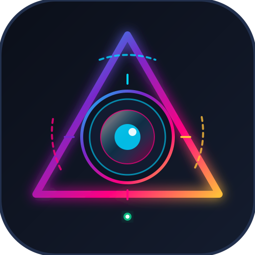

# PrismCam

<p align="center">
  
</p>

<p align="center">
  <strong>Controle PTZ, varredura de rede e captura de câmeras IP para produção de vídeo e OBS Studio.</strong>
</p>

<p align="center">
  
  
  
  
</p>

---

## Sobre o Projeto

O **PrismCam** é uma aplicação para operadores de transmissão e produção ao vivo com câmeras PTZ conectadas em rede (com foco em Datavideo e expansível para ONVIF e outros protocolos).

Principais objetivos:
1. **Identificar câmeras:** Varredura automática na sub-rede local ou cadastro manual por IP.
2. **Streaming em tempo real no navegador:** Monitoramento com latência ultrabaixa com chaveamento entre resolução **HD (1080p Main Stream)** e **SD (Sub Stream)**.
3. **Controle PTZ completo:** Movimentação Pan/Tilt em 8 direções, velocidades independentes, Zoom, Foco manual/automático, Home e Presets de 1 a 9.
4. **Integração direta com OBS Studio:** Fontes de vídeo prontas para tela cheia (sem bordas pretas), RTSP e integração com o plugin de docas PTZ do OBS.

---

## Funcionalidades

- **Varredura de Rede:** Descobre câmeras IP conectadas à rede local automaticamente.
- **Cadastro Manual:** Adiciona câmeras com IP estático, porta e credenciais personalizadas.
- **Vídeo ao Vivo (Navegador):** Conversão contínua RTSP para MJPEG com baixa latência, permitindo guiar movimentos em tempo real.
- **Seletor de Qualidade HD / SD:**
  - **HD:** Stream principal 1080p (`/live/av0`), com nitidez máxima para enquadramento e transmissão.
  - **SD:** Sub-stream otimizado (`/live/av1`), ultraleve para redes com menor largura de banda.
- **Controle PTZ:**
  - Movimentos Pan e Tilt em 8 direções com sliders de velocidade.
  - Zoom In/Out e Foco (+ / - manual e modo Auto).
  - Posição Home e chamada de Presets de 1 a 9.
  - Gravação de novos presets (1 a 255) diretamente pela interface.
- **Atalhos de Teclado:**
  - `WASD` ou `Setas direcionais`: Pan e Tilt contínuos.
  - `Q` / `E` ou `+` / `-`: Zoom.
  - `H` ou tecla `Home`: Retorno à posição Home.
  - Números `1` a `9` (linha superior ou teclado numérico Numpad): Chamada imediata do preset.
  - `Esc`: Libera o foco de campos de texto para reativar atalhos imediatamente.
- **Inicializador para Windows:** Arquivo `start.bat` para iniciar o programa com duplo clique sem precisar abrir o terminal.

---

## Tecnologias

- **Backend:** Node.js, Express, FFmpeg (via `@ffmpeg-installer/ffmpeg`), HTTP Proxy.
- **Frontend:** HTML5, CSS moderno (Dark Theme com design glassmorphic) e Vanilla JavaScript modular.
- **Protocolos:** Datavideo CGI/AJAX, VISCA over TCP, RTSP e MJPEG multipart streaming.

---

## Instalação e Execução

### Pré-requisitos
- [Node.js](https://nodejs.org/) versão 18 ou superior instalado.

### Modo Rápido (Windows)
Execute com duplo clique no arquivo:
```cmd
start.bat
```
O inicializador verifica e instala dependências automaticamente na primeira execução e abre o navegador em `http://localhost:4000`.

### Modo Manual (Terminal)
```bash
git clone https://github.com/AnthonyPerotti/PrismCam.git
cd PrismCam
npm install
npm start
```

Acesse no navegador:
```
http://localhost:4000
```

---

## Integração com o OBS Studio

### 1. Captura de Vídeo (Fonte de Navegador — Sem Bordas Pretas)

Para evitar que o vídeo apareça com margens pretas no OBS:

1. No OBS Studio, adicione uma nova fonte do tipo **Navegador (Browser Source)**.
2. No campo **URL**, cole o link dedicado do PrismCam:
   ```
   http://localhost:4000/obs/camera/<id-da-camera>
   ```
3. Defina a **Largura** e **Altura** desejadas no OBS (ex: `1920` e `1080`).
4. Este endpoint ajusta o stream em tela cheia automaticamente sem cortes ou margens pretas.

> **Dica para URL MJPEG direta:** Se você usar a URL direta `http://localhost:4000/api/cameras/<id>/mjpeg?quality=hd`, configure a resolução no OBS para `1920x1080` e, no campo **CSS personalizado** do OBS, adicione:
> ```css
> body { margin: 0; background-color: rgba(0, 0, 0, 0); overflow: hidden; }
> img { width: 100%; height: 100%; object-fit: cover; }
> ```

### 2. Captura de Vídeo via RTSP (Fonte de Vídeo VLC)

1. Adicione uma fonte **Fonte de Vídeo VLC** ou **Fonte de Mídia**.
2. Desmarque a opção *Arquivo local*.
3. Insira o endereço RTSP fornecido na aba **Integração OBS**:
   - Datavideo HD (Main): `rtsp://<usuario>:<senha>@<ip>:554/live/av0`
   - Datavideo SD (Sub): `rtsp://<usuario>:<senha>@<ip>:554/live/av1`
4. Ajuste o buffer de rede para 150ms a 300ms para menor latência.

---

### 3. Controle PTZ pelas Docas do OBS (Plugin OBS-PTZ)

Para controlar o Pan, Tilt, Zoom e Presets diretamente pelas docas do OBS Studio sem precisar sair do programa:

1. Instale o plugin oficial **OBS-PTZ**:
   - Repositório: [https://github.com/glikely/obs-ptz](https://github.com/glikely/obs-ptz)
   - Baixe a versão para seu sistema na seção de Releases do plugin e instale.
2. No OBS Studio, abra o menu **Docks > PTZ** (ou **Ferramentas > PTZ**).
3. Adicione uma nova câmera e configure com os seguintes dados:
   - **Type / Protocol:** `VISCA over TCP` (ou VISCA/TCP)
   - **Camera IP / Host:** O IP da sua câmera (ex: `172.16.1.170`)
   - **VISCA Port:** `1259` *(porta padrão para câmeras Datavideo)*
   - **Camera Address:** `1`
4. Salve a configuração. Agora os controles físicos do OBS moverão sua câmera Datavideo diretamente.

---

## Referência da API REST

O PrismCam possui uma API local para integração com scripts, Stream Deck ou automações cURL:

| Método | Rota | Descrição | Parâmetros |
|---|---|---|---|
| `GET` | `/api/cameras` | Lista as câmeras cadastradas | - |
| `POST` | `/api/cameras` | Cadastra câmera | `{ "ip": "172.16.1.170", "name": "Datavideo", "type": "datavideo" }` |
| `DELETE` | `/api/cameras/:id` | Remove câmera | - |
| `POST` | `/api/cameras/:id/test` | Testa conexão e autenticação | - |
| `POST` | `/api/ptz/:id/move` | Move a câmera | `{ "direction": "up", "panSpeed": 12, "tiltSpeed": 10 }` |
| `POST` | `/api/ptz/:id/stop` | Para o movimento | - |
| `POST` | `/api/ptz/:id/zoom` | Controle de Zoom | `{ "action": "zoomin" \| "zoomout" \| "stop", "speed": 4 }` |
| `POST` | `/api/ptz/:id/focus` | Controle de Foco | `{ "action": "autofocus" \| "focusnear" \| "focusfar" \| "stop" }` |
| `POST` | `/api/ptz/:id/home` | Retorna ao centro (Home) | - |
| `POST` | `/api/ptz/:id/preset/goto` | Move para Preset | `{ "preset": 1 }` |
| `POST` | `/api/ptz/:id/preset/set` | Grava posição no Preset | `{ "preset": 1 }` |
| `GET` | `/api/cameras/:id/mjpeg` | Stream MJPEG contínuo | Query: `?quality=hd` ou `?quality=sd` |
| `GET` | `/obs/camera/:id` | Página full screen para OBS | Query: `?quality=hd&fit=contain` |
| `GET` | `/api/cameras/:id/snapshot` | Snapshot estático JPEG | Query: `?quality=hd` |
| `POST` | `/api/scan` | Dispara varredura na rede | `{ "subnet": "172.16.1", "startIp": 1, "endIp": 254 }` |

---

## Estrutura de Arquivos

```
PrismCam/
├── .gitignore               # Regras do Git (ignora dados locais, credenciais e testes)
├── README.md                # Documentação técnica do projeto
├── LICENSE                  # Licença de uso não-comercial
├── package.json             # Dependências e metadados
├── start.bat                # Inicializador rápido para Windows
├── public/                  # Interface Web
│   ├── index.html           # Estrutura do painel de controle e abas
│   ├── assets/
│   │   └── icon.svg         # Ícone vetorial do projeto
│   ├── css/
│   │   └── style.css        # Estilos, tema dark e componentes visuais
│   └── js/
│       └── app.js           # Lógica do painel, atalhos, PTZ e OBS
└── src/                     # Servidor e Lógica de Negócio
    ├── server.js            # Servidor Express, rotas da API e endpoints OBS
    ├── stream-manager.js    # Multiplexação e streaming RTSP para MJPEG (HD/SD)
    ├── camera-manager.js    # Gerenciamento de câmeras e persistência local
    ├── network-scanner.js   # Varredura de IPs e detecção de portas
    └── protocols/           # Drivers de câmeras
        ├── datavideo.js     # Driver para linha Datavideo (CGI/AJAX/PTZ)
        └── generic-onvif.js # Driver base para câmeras ONVIF
```

---

## Licença

Distribuído sob a licença **Atribuição Não-Comercial (CC BY-NC 4.0 Adapted)**.

- **Permitido:** Você pode usar, copiar, modificar, distribuir e contribuir com o projeto livremente.
- **Créditos:** Deve manter os créditos e atribuição ao autor original (**Anthony Perotti**).
- **Não Comercial:** É proibido o uso, venda ou redistribuição deste software para fins comerciais sem autorização prévia por escrito.

Consulte o arquivo [LICENSE](LICENSE) para o texto completo da licença.
